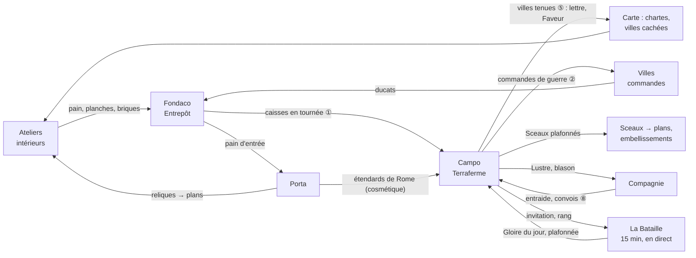

# Audit de la refonte de la Terraferme — l'avis de l'expert Fondaco (8 novembre 2026)

Sources : la branche de la refonte (dernier commit `05f071c3`, `claude/magical-bohr-1x8m5v`, notée **[T]**) et la branche principale (`claude/brave-rubin-8rti3o`, `c2285a1d`, notée **[M]**), plus récente de 92 commits ; base commune `4630f1a1`. La branche [T] n'a que 15 commits propres : 6 400 lignes ajoutées, dont un moteur peu touché (grille carrée, achat de troupes) et beaucoup d'écran (`porcellana/terra/`, `TerraPlay.tsx`).

## 1. Verdict en 5 lignes

1. **Le travail visuel est bon et à garder** : plateau en porcelaine, émail, rubans de front, bâtiments, dock. Il suit la règle 8 (« tout se voit ») mieux que tout ce que la Terraferme a eu jusqu'ici, et son moteur ressemble déjà beaucoup à OpenFront.
2. **L'achat de troupes avec les ducats est une erreur de doctrine.** Il viole l'esprit des règles 4 et 6, et il éloigne les fans d'OpenFront, qui attendent un départ à égalité. Surtout, le vrai problème est plus ancien : forts, bombardes et hausses du maximum se paient déjà en ducats, et **les riches gagnaient déjà 10 semaines sur 10**.
3. **La branche n'est pas fusionnable telle quelle** : 4 conflits (CLAUDE.md, calibration, Lab, catalogue), le test du glossaire cassé par le « vous » (D1), une règle 3 périmée, des niveaux « Casa » faux dans `liens-modes.html`.
4. **La Terraferme ne rapporte presque rien au reste du jeu** : 0,1 % de la progression, pour un plafond fixé à 15 %. Les liens ① (intendance) et ⑤ (villes tenues) sont les bons premiers pas. Il faut y ajouter une boucle complète, où chaque mode est le chemin le plus court vers quelque chose, sans jamais être le seul.
5. **Pour OpenFront**, l'outil existe déjà : l'escarmouche de 15 minutes (`skirmish.ts`), absente de l'empire. Ce qu'il faut faire, c'est un format en direct à armes strictement égales sur le nouveau plateau, pas transformer la semaine en partie de 20 minutes.

## 2. Intégration

### 2.1 Les huit règles d'or

| Règle | Conforme ? | Remarque |
|---|---|---|
| 1. Ton empire t'appartient | **Oui** | Rien de l'empire n'est en jeu sur le plateau. La clôture d'un théâtre ne paie que Faveur, Sceaux et grade (`[M] packages/engine/src/empire/terra.ts:117-168`), et les récoltes du monde mensuel (`payHarvests`) ne sont pas appelées dans l'empire. La bombarde ne libère que des cases du plateau. Les « Pistes écartées » de `liens-modes.html:271` refusent à raison le pillage du Fondaco. |
| 2. Le risque vient de Rome, jamais d'un joueur | **Oui, par exception assumée** | La Terraferme et la Contesa sont les seuls lieux de JcJ (plan de publication, critère 2, `[M] docs/plan-publication.md:150`). Elles le restent tant qu'on n'y perd que ce qu'on y a mis (l'entrée, les ducats dépensés) et que le plateau repart de zéro chaque semaine. Point à surveiller : avec ① et l'achat de troupes, ce qu'on « met » vient de plus en plus de l'empire. |
| 3. Rien ne s'accumule sans fin, et rien ne tourne sans toi | **À reprendre** | [T] porte encore l'ancienne règle « L'absence ne coûte rien » (`[T] CLAUDE.md:27`). La version [M] est celle de D4. Sur le plateau, les recrues montent seules jusqu'au maximum, ce qui reste plafonné, donc conforme. Le magasin du Campo de ① est bien plafonné au besoin de la semaine (`[T] docs/plan-terraferme-porcellana.md:79`). |
| 4. Le temps s'achète, la puissance jamais | **Non dans l'esprit** | Voir 2.2. [T] réécrit la règle en « à armes égales devant l'argent réel », avec une exception pour les troupes (`[T] CLAUDE.md:28`, `[T] docs/CADRAGE-v3.md:33`). |
| 5. Les hauts niveaux se gagnent en jouant | Sans objet | La Terraferme donne des Sceaux, et D2 les échange contre des plans : ça va dans le bon sens. |
| 6. Joueurs de son niveau, Puissance sur le bâti, jamais la caisse | **Lettre oui, esprit non** | Les théâtres se forment bien par bande de Puissance (`[M] empire/terra.ts:178-226`). Mais à l'intérieur d'une bande, c'est la caisse qui décide. Voir 2.2. |
| 7. Quelques minutes, la compagnie aide sans obliger | **Partiel** | La semaine est asynchrone, avec une heure de bataille à 20 h–20 h 30 (`[T] venice1450.settings.ts:269`), ce qui va. En revanche, un absent de deux jours perd ses terres. La partie « pendant ton absence » (T6) répare la lecture, pas la perte. La Contesa oblige un roster le jeudi : c'est une aide, pas une obligation, donc conforme. |
| 8. Tout se voit | **Oui, c'est le point fort** | Émail, vague, ruban, équerres, bâtiments qui montent et qui tombent. Seule faiblesse : ① n'est pas encore fait. Aujourd'hui l'entrée en planches se prend dans un menu (`[M] empire/terra.ts:191-194`), « rien ne roule sur la carte » (`[T] plan-terraferme-porcellana.md:76`). |

### 2.2 L'achat de troupes : la contradiction est réelle, mais elle est plus ancienne

- **Ce qui a été fait** : 20 troupes pour 100 d, 3 fois par jour, sans jamais dépasser le maximum. Voir `[T] packages/engine/src/terraferma.ts:1359`, `[T] terraWorld.ts:555`, `[T] venice1450.settings.ts:324`.
- **Ce qui existait déjà**, tout aussi payé en ducats :
  - le maximum de troupes relevé, à 100 d (`capRaise`, `:321`) ;
  - le fort à 40 d, la bombarde à 150 d (`:313-318`) ;
  - le don de ducats entre alliés, jusqu'à 50 d par jour (`:401`, `terraGift`). Ce don n'est pas bloqué dans l'empire (`[M] empire/terra.ts:241` ne bloque que le décret et l'embargo).
- **La mesure** (`[T] docs/calibration.md`, section ajoutée) : sans la vente, un riche est déjà Signore 10 fois sur 10. La vente lui ajoute 12 % de Gloire. La question 3 du plan (`[T] plan-terraferme-porcellana.md:112`) le reconnaît.

**Pourquoi c'est une contradiction :**

1. **La règle 4 du cadrage** : « La Terraferme et la Contesa restent à armes égales » (`[M] docs/CADRAGE-v3.md:31`). Le § 8 le répète : « À armes égales, quel que soit le niveau de la Casa… une ration journalière égale pour tous plafonne l'avantage des riches ». La réécriture de [T] ne protège plus que contre l'argent réel, et vide la promesse de son contenu.
2. **La règle 6 calcule la Puissance sur le bâti pour que la caisse ne pèse pas.** Apparier par le bâti puis laisser la caisse décider du combat revient à contourner la règle. Deux Maisons de même bande peuvent avoir des caisses de 1 à 10 : celle qui épargne au lieu de bâtir reste dans une bande basse et y écrase tout.
3. **Une échelle cassée.** Les prix sont fixes, alors que les revenus de l'empire vont de 50 d par jour au niveau 5 à 7 500 d par jour à 18 mois (`[M] docs/calibration.md:1740`). En bande 1, l'achat décide la semaine. Dans les bandes hautes, tout le monde achète au maximum : l'achat devient un péage de trois touches par jour, sans aucun choix.
4. **Le risque futur.** Quand les perles viendront (D3 les reporte), elles accéléreront des chantiers, qui donnent des ducats, qui achètent des troupes. On aurait une chaîne indirecte « payer pour gagner », exactement ce que la règle 4 interdit.
5. **La validation.** La mesure ne vient que du simulateur d'une semaine (`terra-buy`). Le puits d'environ 30 d par marchand et par jour n'est pas passé au simulateur de 24 mois, que CLAUDE.md exige pour tout changement d'équilibrage.

**Ma recommandation** : remplacer `capRaise`, `troopBuy` et le prix en ducats des bâtiments par **un trésor de guerre de la semaine, le même pour tous dans un théâtre**. Par exemple, chacun peut engager au plus N ducats dans la semaine, avec N tiré du revenu médian de la bande. Le commerce compte (il faut avoir ces ducats), mais le plafond est égal pour tous. Mieux encore, et plus fidèle au cadrage : **la force vient des marchandises livrées par la route (①)**, plafonnées pareil pour tous. Ce qui coûte alors, c'est du temps de véhicule et des ateliers qui tournent, pas la caisse. Garder les ducats seulement comme une option, dans ce plafond. À trancher par le porteur (Q1).

### 2.3 Cohérence avec le plan de publication et D1–D12

- **Glossaire et « tu » (D1)** : [T] dit « Vos terres », « Votre camp », « Votre allié », « Défenseurs par case chez vous », « ⚔ … sur vous », « Touchez… » (`[T] apps/web/src/i18n.ts`, bloc `empire.terra.play`). Le test `[M] apps/web/test/glossary.test.ts` (« says tu, never vous ») **échouera à la fusion**. Le plan lui-même dit « Pendant votre absence » (`:54`, `:100`). `liens-modes.html` parle encore de « Casa 4 », « Casa 10 » (`:99`, `:251-252`).
- **Les niveaux d'ouverture** : [M] ouvre la Terraferme au Fondaco niveau 5 (`[M] themes/venice1450.empire.ts:262`, `camp: { costDucats: 600, casa: 5 }`, lot 2) et la Porta au 3 (découverte) puis au 4. Le tableau des paliers de `liens-modes.html` (Porta « dès la Casa 10 », Terraferme « dès la Casa 4 ») est donc faux. À refaire avant de servir de référence.
- **Le masquage (D1)** : la synthèse demande de masquer « Terraferme/Campo/partie rapide avant la Casa 4 » (`[M] docs/audit-joueurs-2026-11-07/00-synthese-chef-de-projet.md:91`). C'est compatible : le Campo n'apparaît qu'au niveau 5.
- **La bêta** : le plan de publication **ne prévoit aucun lot pour la Terraferme**. Elle n'y paraît qu'avec l'ouverture au niveau 5 (lot 2, `:167`) et le critère 2 (`:150`). La refonte est donc **hors du plan qui prime**, et la règle D12 (« une PR par lot ») ne la couvre pas. C'est le lot 9 de Porcellana (`[T] plan-terraferme-porcellana.md:13`). Problème pratique : une bêta a peu de joueurs. Un théâtre de 3 humains contre les nations est triste, et les bots marchands de l'empire ne sont pas faits (`[M] IDEAS.md:121`).
- **D3, bêta sans perle** : sans perle, la règle 4 n'a rien à protéger pour l'instant, mais l'exception des troupes prépare un piège pour plus tard.
- **D4** : la nouvelle règle 3 n'est pas reprise dans [T]. Voir le tableau.

### 2.4 « Chaque système absorbe les anciens »

La synthèse compte la Terraferme comme **un** des douze systèmes visibles (`synthèse:289`). Sous ce nom, le joueur rencontre pourtant :

- le camp, cinq bâtiments (fort, bourg, port, bombarde, remparts) ;
- les fronts et les débarquements par la mer ;
- les alliances, 4 signaux, les dons de troupes et de ducats ;
- la hausse du maximum et l'achat de troupes ;
- la ration de la République, l'heure de bataille, les nations et Milan ;
- la Contesa et ses rosters, plus la Condotta et l'escarmouche à côté.

C'est **trop pour un niveau 5 en bêta**. Ce que j'absorbe :

- **Hausse du maximum + achat de troupes → un seul geste, « Renforts »**, dans le trésor de guerre (2.2).
- **Bourg** : le porteur l'a gardé. Je le garderais *fermé* pour la bêta, puisqu'il double le fort comme « bâtiment de bonus ».
- **Bombarde** : la garder, c'est le geste spectaculaire que cherchent les fans d'OpenFront. Mais l'ouvrir à partir du mercredi.
- **Don de ducats entre alliés → supprimé.** C'est un canal de transfert de ducats entre comptes. Il ouvre la porte aux multi-comptes et au commerce de ducats contre de l'argent réel, contre la règle 4. Le don de troupes suffit.
- **Curseur paysans/soldats** : il n'est pas dans l'écran de [T], et sans récolte dans l'empire il n'aurait pas de sens. À couper aussi dans les réglages de l'empire.
- **Condotta + escarmouche → un seul mode en direct**, « la Bataille ». Voir le § 4.

### 2.5 Conflits techniques et de doctrine à la fusion

`git merge-tree` donne **4 conflits** :

- `CLAUDE.md` : règle 3 de [M] + exception de la règle 4 de [T] ; les lignes « plan de publication » et « premiers pas » disparues de [T] ;
- `docs/calibration.md` : les deux branches ajoutent à la fin ;
- `apps/web/src/porcellana/Lab.tsx`, `catalogue.ts`.

Fusion automatique mais à relire : `i18n.ts`, `i18n.en.ts`, `commands.ts`, `tx.ts`, `venice1450.settings.ts`, `porcellana.css`, `CADRAGE-v3.md`.

Il faut ensuite :

1. traduire au « tu » tout le bloc `terra.play` et les textes du plan ;
2. vérifier que la nouvelle commande `terraBuyTroops` passe par la liste blanche du lot 0 (P0-01, clés réservées) ;
3. décider de la règle 4 (Q1) **avant** de fusionner le texte du CLAUDE.md : si le porteur revient sur l'achat, on ne fusionne pas l'exception ;
4. garder la bascule `terraferma.grid: "square"` (T7) éteinte : elle prend effet le lundi suivant, sur décision du porteur.

## 3. Interdépendance des modes

### 3.1 Ce qui relie déjà la Terraferme au reste

| Sens | Ce qui circule | Où |
|---|---|---|
| Commerce → Terraferme | Entrée de 20 planches, prise à Venise par un menu | `[M] empire/terra.ts:191-194`, `empire/settings.ts` (`entry`) |
| Commerce → Terraferme | Pain des troupes au-delà de la ration de 20 par jour ; briques, planches et bois des bâtiments | `terraWorld.ts:209` (`serveTerraRations`), `supply.buildingMaterials` |
| Commerce → Terraferme | Ducats (bâtiments, maximum, troupes, dons) | voir 2.2 |
| Fondaco → Terraferme | Le Campo, bâti au niveau 5 pour 600 d | `[M] venice1450.empire.ts:262` |
| Terraferme → Empire | Faveur par rang, Sceaux (2 par semaine au plus), grade ; pour la Contesa : trophée, Lustre, blason des villes tenues | `[M] empire/terra.ts:117-168` |
| Compagnie ↔ Terraferme | Rosters de Contesa, appariement par somme des Puissances | `[M] empire/terra.ts:249-330` |

Bilan : la part de la Terraferme dans la progression est de **0,1 %** (`[M] docs/calibration.md:1890-1904`), loin du plafond de 15 %. Les liens existent, mais ils sont **invisibles** (des menus) et **sans poids**. Le marchand qui ne fait pas la guerre ne la remarque même pas.

### 3.2 Les neuf propositions de `liens-modes.html`

| Lien | Avis | Pourquoi |
|---|---|---|
| ① Intendance par la route | **Oui, en premier** | Il réutilise la tournée et ne crée aucun système. Il rend la guerre visible sur la carte du commerce. C'est **le bon remplaçant de l'achat en ducats** : le coût devient du temps de véhicule, pas de la caisse. Les décisions du porteur (magasin du Campo d'abord, puis Venise ; rien de gagné à livrer) gardent la règle 7. |
| ② La guerre fait les prix | **Oui, en version simple** | C'est le seul lien qui rend la Terraferme utile au non-combattant, et c'est la vraie colle pour la règle 7. Je le ferais passer par les **commandes** (une ville assiégée publie une commande de guerre, plafonnée), plutôt que par les prix (indice de 80 à 130, risque d'inflation). |
| ③ Les cartes anciennes | Oui, plus tard | Porta → carte. Pas de lien avec la Terraferme. |
| ④ Les spolia | Prudence | Une marchandise de plus et un nouveau coût du Fondaco. C'est l'économie entre joueurs que le cadrage veut (§ 7), mais ça demande le simulateur de 24 mois. |
| ⑤ Les villes tenues | **Oui** | Visible (la bannière sur la carte de tous), plafonné, sans rendement. Attention : une ville « tenue » sur un plateau par théâtre se retrouve tenue par plusieurs Maisons dans le même monde. Une bannière par théâtre et par bande, ou la Maison du meilleur rang ? À trancher (Q5). |
| ⑥ Studiolo et façade | Oui, pas cher | Du prestige pur. Le cadrage prévoit déjà « les bannières sur la façade » (§ 8). Il rejoint les embellissements des Sceaux du lot 5. |
| ⑦ La journée en trois temps | **Oui, comme colle** | Le Carnet en trois colonnes et « Ça t'attend ». Il faut deux chemins par objectif pour rester dans la règle 7. |
| ⑧ La Contesa à trois métiers | Oui, en dernier | Le cadrage la prévoit déjà (« les non-inscrits ravitaillent par l'entraide », `[M] CADRAGE-v3.md:482`). C'est ① appliqué au camp de la compagnie. |
| ⑨ Les troupes achetées | **Non** (voir 2.2) | C'est le seul lien qui transmet de la **puissance** au lieu du temps ou du prestige. |

### 3.3 Mes propositions : une boucle où chacun a besoin des autres sans y être obligé

Principe, repris de `liens-modes.html:248` : **chaque mode est le chemin le plus court vers quelque chose, jamais le seul**. On ajoute deux garde-fous :

- vers la Terraferme, il ne circule que du **temps** et de la **logistique plafonnée** ;
- depuis la Terraferme, il ne sort que du **prestige**, de l'**accès** et des **occasions**, jamais du rendement.

| # | Lien | Ce qui circule, et dans quel sens | Plafond | Équité (règles 4 et 6) | Ce qu'on voit (règle 8) | Effort |
|---|---|---|---|---|---|---|
| A | **Intendance par la route** (①, en remplacement de ⑨) | Pain, planches et briques : Entrepôt → magasin du Campo, par les véhicules | Besoin de la semaine, **le même pour tous** ; la ration de la République en premier | Le coût est du temps de véhicule, pas la caisse ; la ration nourrit seule les petites Maisons | Charrettes du Fondaco au Campo, caisses au quai, anneau de pain autour du camp sur le plateau | M (le Campo comme arrêt de tournée) |
| B | **Renforts du trésor de guerre** | Ducats ou marchandises → troupes et bâtiments | Un **trésor de la semaine égal** pour tous dans un théâtre | La caisse ne compte que jusqu'au plafond ; une fois le plafond atteint, plus d'avantage | Un coffre au camp qui se vide ; « Renforts » dans le dock | S (moteur), M (simulateur) |
| C | **Les commandes de guerre** (② simplifié) | Terraferme → villes de la carte du commerce : une ville disputée publie des commandes (pain, fer, planches), ouvertes à tous | Dans le plafond de commandes de la ville, par théâtre agrégé | Elles profitent aussi au marchand qui ne se bat pas : c'est la règle 7 | Fumée et bannières sur la ville, caisses rouges de commande | M (+ simulateur de 24 mois) |
| D | **Les villes tenues** (⑤) | Terraferme → carte : bannière + lettre de la Signoria (une part de charte ou un voyage d'ouverture raccourci) | Dans les 10 à 15 % ; une lettre par semaine | Du prestige et de l'accès, pas du rendement | Bannière sur Vérone ou Padoue, couronne du Signore | S à M |
| E | **Les Sceaux de guerre → plans** | Terraferme → ateliers et Porta (D2 : les Sceaux s'échangent contre des plans) | 2 Sceaux par semaine (déjà en place) | Règle 5 respectée : on les gagne en jouant ; la Porta reste le chemin principal | Le plan déroulé à l'atelier | S (déjà là, à montrer) |
| F | **Les étendards de Rome** | Porta → Terraferme : une relique « étendard » se plante sur le camp, purement visuelle | Aucun effet de jeu | Aucun effet | Étendard au-dessus du camp, vu par tout le théâtre | S |
| G | **Les convois de compagnie** (⑧) | Associés → camp de la compagnie pendant la Contesa ; Lustre et blason en retour | Plafond du camp | Égal sur le front | Convois de plusieurs couleurs vers un même camp | M |
| H | **La Bataille du jour** (pont OpenFront, § 4) | Partie en direct de 15 min → Gloire de la semaine | **Une partie classée par jour** (`rankedPerDay: 1`, `[M] venice1450.settings.ts:367`) | Strictement égale (§ 4) | Le même plateau en porcelaine, en accéléré | M (porter `skirmish` dans l'empire) |
| I | **Le Carnet en trois colonnes** (⑦) | Objectifs commerce / Porta / Terraferme → Faveur et Sceau | Carnet actuel | Deux chemins par objectif | Le triptyque du Carnet ; le Campo et la Porta qui s'allument à leur heure | S |

La boucle tourne ainsi. Les ateliers nourrissent la guerre (A) et la Porta. La guerre rend des commandes au commerce (C), ouvre la carte (D), donne des Sceaux qui deviennent des plans (E). La Porta rend des plans aux ateliers et du prestige au camp (F). La compagnie amplifie (G). La Bataille fait entrer les nouveaux joueurs et rythme la semaine (H). Le Carnet relie le tout au quotidien (I).

Ce qui rend le tout sûr pour les règles 1, 4 et 7 :

- personne n'est **obligé** de passer par un mode : la ration nourrit l'absent, et les commandes de guerre paient le pacifique ;
- rien ne sort de la Terraferme en rendement ;
- rien n'y entre au-delà d'un plafond égal pour tous.

## 4. Le rapprochement avec OpenFront, vu de Fondaco

**Ce que la Terraferme a déjà d'OpenFront** :

- un territoire qui s'étend case par case ;
- un front qui engage un pourcentage de troupes (le « curseur des hommes ») ;
- des recrues qui montent avec la terre jusqu'à un maximum ;
- les nations comme joueurs de l'ordinateur ;
- une phase de placement avec protection ;
- les alliances qu'on rompt avec un préavis et les signaux (l'équivalent des emojis) ;
- le port et les débarquements ;
- la bombarde (l'équivalent du missile), les remparts (de la défense anti-missile), le fort (du poste de défense).

Le passage à quatre voisins rapproche encore le plateau de la grille de pixels d'OpenFront. Et le moteur a **déjà** une partie en direct de 15 minutes à 8 joueurs, en temps 60 fois plus rapide (`[M] packages/engine/src/skirmish.ts:1-5`, réglages `venice1450.settings.ts:357-370`). Elle n'existe que dans le monde mensuel (`/api/game/skirmish`, `[M] apps/server/src/game/routes.ts:771`), pas dans l'empire.

| Élément d'OpenFront | Compatible ? | Pourquoi |
|---|---|---|
| Partie en direct de 15 à 20 min | **Oui, comme mode à part, ramené à 12–15 min** | La règle 7 veut des modes en direct courts, « une dizaine de minutes ». 20 min, c'est déjà trop ; 12 à 15 min, ça passe. Mais elle ne doit **pas remplacer la semaine**, que le cadrage fixe (§ 1 et § 8 : « une guerre d'une semaine »). Deux formats sur le même moteur et le même plateau : **la Semaine** (asynchrone) et **la Bataille** (en direct, quand on veut, en file par cote). La Bataille nourrit la Semaine (H). |
| Départ strictement égal, or gagné dans la partie | **Oui, et c'est la condition** | C'est le contrat moral d'OpenFront. La Bataille utilise une monnaie de partie (« florins de campagne », gagnés par la terre et les routes de ports), **jamais les ducats de l'empire**. C'est un argument de plus contre l'achat de troupes. |
| Routes commerciales entre ports qui rapportent de l'or | **Oui, très Fondaco** | Le commerce au cœur de la guerre : nos galères entre ports, l'or de la partie aux deux ports. C'est l'identité du jeu. |
| Bombes atomiques, bombe H, ogives multiples | **Non** | Anachroniques pour 1450, et destructrices pour toute une carte. La bombarde (portée 4, un tir par jour et par pièce) suffit. En direct, on peut ajouter la **grande bombarde** (Constantinople, 1453), à un tir par partie. La règle 2 ne s'applique pas, puisque rien de l'empire n'est touché, à condition que ça reste vrai. |
| Trahison d'alliance | Oui | « Rompre (effet dans 2 h) » existe déjà ; en direct, 30 secondes. Une marque « parjure » visible sur l'émail suit la règle 8. |
| Grandes cartes à 100 joueurs et plus | Partiel | Les théâtres de l'empire font 40 joueurs au plus, par bande. Pour la Bataille, 8 à 16 humains complétés par des nations, c'est réaliste pour une bêta. |
| Appariement sans niveau | **Question à poser** | La règle 6 veut des bandes de Puissance. Pour un mode à armes strictement égales, la Puissance n'a pas de sens : apparier **par la cote seule** élargit les files. Il faut une décision du porteur (Q4). |
| Jouable tout de suite, sans compte | **Conflit** | Les fans d'OpenFront cliquent et jouent tout de suite. Fondaco ouvre la Terraferme au niveau 5 et masque tout avant (D1). Proposition : la Bataille ouverte **dès le premier jour** comme porte d'entrée, sans rien rapporter à l'empire avant le Campo. C'est le meilleur outil d'acquisition du jeu. À trancher (Q3). |
| Clics rapides à la souris | À adapter | Mobile d'abord : toucher une case, tirer le curseur. La maquette T5 le fait déjà. |

En résumé : **la Semaine reste Fondaco, la Bataille parle à OpenFront, le plateau et le moteur sont communs.** C'est aussi ce qui permet d'absorber la Condotta, l'escarmouche et la Bataille en un seul mode.

## 5. Recommandations et ordre des lots

**Priorité 0, avant la fusion :**

1. **Ne pas fusionner l'exception de la règle 4** tant que Q1 n'est pas tranchée. Désactiver `troopBuy` dans le thème (il est déjà fermé quand il est absent), sans toucher au code.
2. Rebaser [T] sur [M] :
   - résoudre les 4 conflits ;
   - garder la règle 3 de D4 ;
   - passer `terra.play` au « tu » (le test du glossaire doit passer) ;
   - corriger « Casa » et les niveaux dans `liens-modes.html` et le plan.
3. Vérifier `terraBuyTroops` contre la liste blanche du lot 0 et le fuzz.
4. Fusionner **le plateau, les fronts, les bâtiments et l'interface (T1 à T5)** derrière `grid: "hex"`. Le moteur carré reste éteint, ce qui ne pose aucun risque pour les joueurs.

**Ensuite, dans l'ordre :**

| Lot | Contenu | Pourquoi d'abord |
|---|---|---|
| T5b | ① L'intendance par la route + le trésor de guerre égal (B) ; retirer capRaise, troopBuy et le don de ducats | Il corrige la doctrine et rend la guerre visible sur la carte. Simulateur de 24 mois. |
| T6 | Le retour en accéléré + ⑤ les villes tenues | Déjà prévu. |
| T6b | **La Bataille** : porter `skirmish` dans l'empire, sur le plateau Porcellana, en absorbant la Condotta ; une partie classée par jour | Le pont OpenFront et le remède aux théâtres vides de la bêta. |
| T7 | Bascule de la grille carrée un lundi | Décision du porteur. |
| T8 | ② les commandes de guerre, ⑦ le Carnet en trois colonnes, ⑥ la façade | La colle. |
| T9 | ⑧ la Contesa à trois métiers, F les étendards de Rome | En dernier. |

**Pour la bêta** : ouvrir la Bataille (avec des bots) plutôt que la Semaine si la population est faible, ou remplir les théâtres de bots marchands (`IDEAS.md:121`). Une Semaine à 3 humains ferait une mauvaise première impression.

**Questions au porteur :**

1. **L'achat de troupes** : le garder, sachant que les riches gagnent 10 fois sur 10 même sans lui ? Ou le remplacer par un trésor de guerre égal pour tous dans le théâtre, et par l'intendance par la route ? (Ma recommandation : le remplacer.) Plus largement : faut-il plafonner toute dépense en ducats à la Terraferme (forts, maximum) ? C'est ta question 3 du plan.
2. **La refonte dans le plan de publication** : faut-il en faire un lot 8 de la bêta, ou la garder pour après ?
3. **La Bataille comme porte d'entrée** : jouable dès le premier jour, avant le Fondaco niveau 5, pour attirer les fans d'OpenFront ? Ça déroge à D1, qui masque la Terraferme.
4. **L'appariement de la Bataille par la cote seule**, sans bande de Puissance, puisque les armes y sont strictement égales (règle 6) ?
5. **Les villes tenues** : une bannière par théâtre, ou seulement celle du meilleur théâtre de la bande ? Que se passe-t-il quand deux Maisons « tiennent » Vérone la même semaine ?
6. **Le don de ducats entre alliés** (50 d par jour) : le supprimer dans l'empire, comme canal de transfert entre comptes ?
7. **Le Bourg** : gardé, mais fermé pour la bêta ?
8. **La durée de la Bataille** : 12 à 15 minutes (règle 7), ou s'aligner sur les 20 minutes d'OpenFront en assouplissant la règle ?
