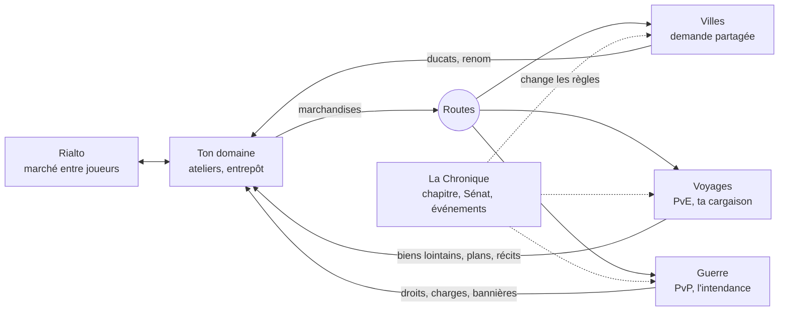

# Fondaco — plan global : « la Sérénissime » (proposition de cadrage v4)

*Proposition du 10 novembre 2026, à la demande du porteur : « oublie toutes les règles mises en place, tu peux absolument tout remettre en question […] il faut que Fondaco soit un vrai jeu complet de stratégie-gestion, innovant ». **Rien n'est décidé, rien n'est codé.** Ce document ne remplace CADRAGE-v3 et les plans en cours que s'il est validé ; les questions à trancher sont au § 15.*

*Méthode : lecture du cadrage (CADRAGE-v3), des audits (joueurs du 7 novembre, gameplay du 5, profondeur du 1er, Terraferme du 8), des plans en cours (publication, Porcellana, Porta, Terraferme, ateliers), des captures du jeu ; recherche sur une vingtaine de jeux de référence et sur ce qu'en disent critiques et joueurs (§ 2, sources au § 16). Limite : le réseau de la session refuse `steamcommunity.com`, Reddit et la plupart des sites de presse en lecture directe ; les avis viennent donc des résultats de recherche (critiques, agrégateurs d'avis Steam, fils de forum cités), pas d'une lecture page par page.*

---

## 0. Le plan en une page

**Le constat.** Fondaco a une direction artistique rare (Porcellana), un socle technique sérieux (moteur pur, grand livre, simulateur) et trois modes qui marchent chacun un peu. Mais ce sont **trois jeux posés côte à côte** : un jeu de livraisons repris d'Hades' Star, une bataille tactique contre Rome, une guerre de territoire reprise d'OpenFront. Ils n'ont ni la même carte, ni les mêmes ressources, ni la même histoire. Et le cœur, le commerce, **ne demande aucune décision** : une session dure trente secondes, le jeu choisit les livraisons, aucun autre joueur n'existe dans l'économie. La profondeur vient de l'attente (des chantiers jusqu'à douze jours), pas des choix.

**La thèse.** Fondaco ne deviendra pas une référence en imitant mieux ses modèles. Il le deviendra en prenant au sérieux ce que **Venise a réellement inventé** : le convoi d'État mis aux enchères, le voyage financé à plusieurs, l'assurance, la guerre faite par contrat. Ce sont des mécaniques de jeu toutes prêtes, et aucun jeu de gestion multijoueur ne les a mises au centre.

**Cinq idées fortes :**

1. **Une seule matière : la cargaison.** Tout ce que tu produis part quelque part : nourrir une ville, charger un convoi, tenir une guerre. Les trois modes consomment et rendent les mêmes marchandises, par les mêmes routes, sur la même carte. Le PvE n'est plus « une bataille à côté » : c'est ton voyage de commerce, avec ta vraie cargaison dedans.
2. **On te devance, on ne te vole pas.** Les joueurs se rencontrent enfin dans l'économie : un marché commun, des villes dont la demande est partagée, des ouvrages (pont, canal, entrepôt) qu'un joueur bâtit et que les autres empruntent contre péage. Personne ne pille personne.
3. **Ta Maison est éternelle, le monde avance par chapitres.** Rien de ce que tu bâtis ne se remet à zéro. Mais le monde, lui, raconte une histoire : un chapitre de six semaines par année de 1450 à 1454, avec sa crise, sa question politique, son comptoir d'outre-mer à fonder, et une fin écrite par ce que les joueurs ont fait.
4. **Des voyages qu'on a envie de jouer.** Le PvE devient un voyage par étapes (trois minutes chacune) où l'on choisit sa route, où l'ennemi annonce ses coups, où l'on arbitre entre gardes et cargaison, et où un corsaire qui t'a battu prend un nom et revient.
5. **La porcelaine vivante.** La même planche de porcelaine pour tout (domaine, monde, voyage, guerre), un zoom continu entre les échelles, et une matière qui raconte : biscuit pour ce qui dort, émail pour ce qui vit, fêlure pour ce qui a souffert, filet d'or pour ce qui a été réparé.

**Ce que ça remplace.** L'échelle de vingt niveaux à minuteurs comme seule colonne vertébrale, les livraisons choisies par le jeu, Rome comme ennemi sans raison, la Terraferme sans effet sur le reste, cinq monnaies de récompense, trois grammaires de plateau.

**Ce que ça garde.** Porcellana, le moteur et ses invariants, le simulateur, les tutoriels guidés, le convoi et les ordres de la Porta (lots A et B), la Bataille de douze minutes et ses liens d'invitation, la grille carrée achetée case par case.

---

## 1. Le diagnostic

### 1.1 Ce qui est bon et qu'on garde

| Acquis | Pourquoi il compte |
| --- | --- |
| **Porcellana** | Une identité visuelle qu'on reconnaît en une image. Les six testeurs du 7 novembre notent les dix premières minutes « au niveau d'un jeu commercial ». |
| **Le socle technique** | Moteur pur partagé par le serveur et le simulateur, montants entiers, grand livre en partie double, verrou par marché. C'est exactement ce qu'il faut pour une économie entre joueurs. |
| **Le simulateur de 24 mois** | Très peu de jeux de cette taille peuvent mesurer un équilibrage avant de le livrer. |
| **Les lots A et B de la Porta** | Le convoi, les ordres qui disent ce qu'ils font, l'ennemi qui annonce ses coups : la bonne grammaire tactique pour un téléphone. |
| **La Bataille** | Douze minutes, à armes égales, jouable sans compte, avec des robots aux places vides : une vraie porte d'entrée. |
| **La règle « personne ne pille »** | Les joueurs adultes quittent les jeux de conquête pour ça (§ 2, Rise of Kingdoms). À garder, mais sans en faire une interdiction de toute rencontre. |

### 1.2 Les six causes de fond

**A. Trois jeux côte à côte.**

| Mode | Repris de | Son plateau | Ce qu'il consomme | Ce qu'il rend au reste |
| --- | --- | --- | --- | --- |
| Commerce | Hades' Star (cargaisons) | Cases carrées | Du temps | Des ducats |
| Porta | Hades' Star (étoiles rouges) | Hexagones, autre carte | Du pain | Des reliques vendues à un antiquaire |
| Terraferme | OpenFront | Hexagones, autre carte | Un trésor égal | 0,1 % de la progression (audit du 8 novembre) |
| Bataille | OpenFront, escarmouche | Le même que la Terraferme | Rien | Un peu de Gloire |

Aucun de ces modes n'a besoin des autres. Le porteur le dit : « les modes de jeu ne fonctionnent pas bien ensemble et ne racontent pas d'histoire ».

**B. Un jeu de commerce sans commerce.** L'audit du 5 novembre mesure la session : 3 à 8 touchers, trente secondes, aucune décision (« le jeu choisit les commandes, le véhicule, l'ordre »). Les prix sont ceux d'un marché tenu par l'ordinateur, maison par maison. Aucun joueur n'achète à un autre, ne le concurrence sur une ville, ne s'associe à lui pour un voyage. Le mot « multijoueur » ne vit que dans les modes annexes.

**C. La profondeur par l'attente.** La colonne vertébrale est une échelle de vingt niveaux dont les chantiers vont jusqu'à douze jours. C'est le rythme d'Hades' Star, et c'est précisément ce que ses joueurs lui reprochent : une fin de partie « qui demande du dévouement et de la répétition plus que du jeu », des livraisons vécues comme une corvée (§ 2). Les jeux de gestion qu'on cite en référence font l'inverse : on y attend peu, on y décide beaucoup.

**D. Aucune histoire.** Venise en 1450 est un décor. Il n'y a ni personnage (hors Lorenzo), ni rival, ni événement qui change la donne, ni début, ni fin. Pourquoi un marchand vénitien se bat-il contre Rome pour des reliques ? Pourquoi les Maisons se font-elles la guerre en Terraferme ? Le jeu ne répond pas.

**E. La sédimentation.** Une vingtaine de plans en six semaines, chacun écrit en regardant une référence différente. La règle « chaque système absorbe les anciens » est juste, mais elle n'est pas tenue : six mots pour le siège de la Maison, cinq monnaies de récompense dont deux longtemps sans usage, trois directions artistiques dont les restes se voyaient encore le 7 novembre.

**F. Une image superbe, mais immobile et peu lisible.** Trois grammaires de plateau (carrés au commerce, hexagones à la Porta et à la Terraferme) ; du blanc sur du blanc où l'on perd ses pions (constat de la Porta) ; un bouton d'action doré dans un monde dont le seul accent est rouge ; un guide en dessin coloré dans un monde de porcelaine ; peu de vie tant qu'on ne touche rien.

### 1.3 Ce que ça veut dire

Les audits précédents ont surtout corrigé des symptômes (le désert des deux heures, les textes, les repères). Ils ont eu raison de le faire. Mais la note moyenne de 3,6 sur 10 ne vient pas des bogues : elle vient de ce qu'il n'y a **pas encore de jeu au centre**. Le plan qui suit commence donc par le centre.

---

## 2. Ce que disent les jeux de référence et leurs joueurs

| Jeu | Ce que les joueurs aiment | Ce qu'ils lui reprochent | La leçon pour Fondaco |
| --- | --- | --- | --- |
| **Anno 1800, Anno 117** | « La célébration de la chaîne logistique parfaite » ; résoudre un manque en reliant deux îles ; la beauté | La fin de partie « tableur », des outils de suivi insuffisants, des alertes de routes à répétition ; le jeu à deux où l'on se partage les rôles est très apprécié | Le plaisir est de **régler un réseau**, pas de répéter un trajet. Montrer les flux, donner les chiffres, laisser se répartir les rôles entre associés. |
| **Offworld Trading Company** | Un jeu de stratégie en temps réel **sans combat** : on gagne par les prix, les pénuries, les rachats. « Moins un RTS sans combat qu'une simulation de marché où chaque choix est une bataille » | Trop de choses à suivre, des chiffres « sans âme » au bout de quelques heures | Le PvP d'un jeu de commerce peut **être** le commerce. Mais il faut des objets, des lieux et des visages, pas des courbes. |
| **Brass: Birmingham** (3ᵉ jeu de société au classement BoardGameGeek) | On dépend du réseau des autres autant qu'on les concurrence ; personne n'est éliminé, « le pire qui arrive est de gagner moins que les autres » | Long à apprendre, paralysie d'analyse | La rencontre idéale pour notre règle « personne ne pille » : **des ouvrages partagés et une demande limitée**. |
| **Against the Storm** | Des villes courtes et toujours neuves, une progression qui reste ; on échappe à la fin de partie molle des jeux de construction | On ne vit que le début, encore et encore | Garder **le plaisir du départ** sans rien retirer au joueur : des fondations neuves à côté d'une Maison qui dure. |
| **Foxhole** | Ceux qui fabriquent et transportent **sont** la guerre : pas de munitions au front sans eux ; les joueurs se recommandent entre eux | La logistique a fini par épuiser ses volontaires (mouvement L.O.G.I.) | Relier le commerce à la guerre par l'approvisionnement, **avec un plafond**, et sans jamais en faire une corvée obligatoire. |
| **Hades' Star** | Pas de paiement pour gagner ; un plancher bas et un plafond haut | Les étoiles blanches qui épuisent ; « la fin de partie insiste sur le dévouement et la répétition plus que sur le jeu » ; livrer des cargaisons vécu comme une corvée ; un ancien joueur parle d'« un jeu mort » | Ne pas hériter de ses défauts : **déléguer la routine** quand le joueur grandit, et raccourcir les minuteurs. |
| **OpenFront** | Simple, immédiat, la diplomatie imprévisible entre humains (86 % d'avis positifs sur Steam) | Les ententes en partie libre, les coéquipiers faibles ou absents, la boule de neige des grands empires (que les mises à jour plafonnent) | Pour la Bataille : des alliances déclarées et limitées, des équipes formées par la compagnie, un frein à la boule de neige. |
| **Into the Breach** | Tout coup ennemi est annoncé ; chaque perte est sa propre faute | — | Déjà repris par le lot A de la Porta. À étendre à tout le PvE. |
| **Bad North, Thronefall** | Le minimalisme qui garde l'essentiel ; la couche de parcours qui donne envie de repartir | « Mise sur la simplicité au détriment de la profondeur » ; n'accroche pas les vétérans | L'épure visuelle ne dispense pas de la profondeur : il faut un vrai choix d'équipement et de chemin. |
| **Mechabellum** | « Poser de meilleures questions, tour après tour » : lire l'adversaire, lui répondre ; des parties de 10 à 20 minutes | Dur à apprendre, des mécaniques cachées | Pour la Bataille : une courte phase où l'on choisit ses atouts en réponse à l'adversaire. |
| **Mini Motorways, Dorfromantik, Islanders** | Une règle simple, un retour immédiat, le score de voisinage qu'on voit tomber | Répétitif sans but (Islanders, Townscaper) | Montrer le gain d'un placement **avant** de poser ; toujours un but visible. |
| **80 Days, Sunless Sea** | 80 Days : la route choisie décide des histoires qu'on vit, et le commerce y est tissé | Sunless Sea : le commerce et le récit se gênent | Le récit doit naître **de la route et de la cargaison**, pas s'y ajouter. |
| **Crusader Kings, RimWorld** | Des histoires que personne n'a écrites, parce que des personnages nommés agissent | — | Des personnages avec un nom et une mémoire (famille, rivaux, capitaines ennemis), et un journal qui garde la trace. |
| **Port Royale 4, Rise of Venice** | Un bon simulateur de commerce | « Aller-retour entre les mêmes villes avec les mêmes biens », puis « un jeu d'attente où les chiffres grossissent » ; des combats lents | Acheter bas et vendre haut **ne suffit pas**. Il faut des événements, des rivaux et du risque. |
| **Prosperous Universe, Sim Companies** | Une économie tenue par les joueurs, des chaînes qui traversent plusieurs entreprises | Début lent, peu de stimulation visuelle ; une petite population grippe tout le marché | Un marché entre joueurs **doublé d'un teneur de marché** pour qu'il fonctionne à cent joueurs comme à dix mille. |
| **Rise of Kingdoms, Lords Mobile** | — | Payer pour gagner, les gros payeurs qui écrasent les serveurs neufs, « un cycle de récolte et d'améliorations devenu une corvée » | Jamais de puissance à vendre ; jamais de perte de ce qu'on a bâti. |
| **Path of Exile (ligues)** | Le départ neuf partagé par tous ; l'éditeur estime que l'essentiel du jeu se passe dans les ligues | Ceux qui veulent garder leurs acquis vivent mal la remise à zéro | Un **monde** qui se renouvelle, des **acquis** qui restent : les deux à la fois. |
| **Subterfuge, Neptune's Pride** | Des parties d'une semaine, des sessions de quelques minutes, la diplomatie comme cœur | Épuisant : il faut surveiller, on y perd le sommeil | Pour la guerre de la semaine : des ordres programmés, pas de prime à la veille. |
| **Dune: Spice Wars** | Gagner par la politique et l'économie, pas seulement par les armes | Diplomatie et commerce « légers », aucun récit pour s'attacher | Mélanger économie, politique et guerre ne marche que si chacune a du poids. |
| **Frostpunk 2** | Les factions et les votes qui donnent un sens aux choix | Interface et repères insuffisants | Une question politique par chapitre, votée, avec des conséquences visibles. |

**Trois conclusions.**

1. Les jeux de gestion qu'on admire reposent sur **des décisions de réseau** (où placer, quoi relier, à qui vendre), pas sur des minuteurs.
2. Les jeux de commerce échouent quand il n'y a que des prix. Ils réussissent quand il y a **des rivaux, des événements et du risque choisi**.
3. Personne n'a encore réuni, pour un jeu multijoueur jouable en cinq minutes : une économie entre joueurs sans pillage, un PvE qui porte la vraie cargaison, une guerre nourrie par le commerce, et un monde qui raconte. C'est la place à prendre.

---

## 3. La vision

**Le pitch.** *Venise, 1450. Tu ouvres un fondaco avec une mule. Tout ce que tu fabriques part quelque part : au marché, sur les routes, dans la cale d'une galée, vers une armée. Tu ne pilles personne et personne ne te pille, mais tout le monde vise les mêmes villes, les mêmes convois et les mêmes sièges au Sénat. Et pendant ce temps le siècle avance : Milan menace, Constantinople va tomber, et c'est vous tous qui écrivez la suite.*

**Ce qui est neuf dans le genre.** Le commerce n'est pas un mode parmi d'autres : c'est la matière des trois autres.

### 3.1 Les nouvelles règles d'or (proposition)

Elles remplaceraient les huit règles du 1er novembre. Trois sont gardées, deux sont inversées, trois sont nouvelles.

| # | Règle proposée | Par rapport à aujourd'hui |
| --- | --- | --- |
| 1 | **Ta Maison t'appartient.** Personne ne prend ni ne détruit ce que tu as bâti. | Gardée. |
| 2 | **On te devance, on ne te vole pas.** Les joueurs se rencontrent par le marché, les enchères, les routes et les positions disputées. On ne risque que ce qu'on a choisi d'engager (une cargaison, une mise). | Remplace « le risque ne vient jamais d'un autre joueur », qui interdisait toute économie commune. |
| 3 | **Chaque session a une décision qui compte.** Aucune session n'est une simple récolte. Ce qui devient routine se délègue. | Remplace « rien ne tourne sans toi » (décision D4 du 7 novembre). Voir § 15, question 2. |
| 4 | **Une carte, une matière.** Tout mode se joue sur la même planche, avec les mêmes marchandises. | Nouvelle. |
| 5 | **À armes choisies, jamais achetées.** L'argent réel n'achète que du confort et de l'apparat. En PvP, ce qu'on engage est plafonné pareil pour tous. | Durcit la règle 4 : plus de vente de temps comme modèle central (§ 9.4). |
| 6 | **Le monde raconte.** Tout événement a une cause, un nom et une trace dans la Chronique. | Nouvelle. |
| 7 | **Tout se voit, et se lit d'un coup d'œil.** L'image d'abord ; un seul accent ; une seule action mise en avant. | Gardée, précisée. |
| 8 | **Court si tu veux, profond si tu restes.** Cinq minutes font une bonne session ; une heure offre plus de décisions, jamais un multiplicateur. | Gardée (règle 7), reformulée. |

### 3.2 Douze systèmes visibles, pas un de plus

| # | Système | Ce qu'il absorbe |
| --- | --- | --- |
| 1 | **Le Domaine** (la planche, les cases, les voisinages) | La carte du domaine, l'achat de cases, les embellissements |
| 2 | **Les Ateliers** | Les ateliers, les intérieurs (réservés au métier de la Maison), les qualités |
| 3 | **L'Entrepôt** | Le stock, ses plafonds, les priorités |
| 4 | **Les Routes** | Les livraisons, la Remise, les véhicules et leurs modules, les ouvrages partagés |
| 5 | **Le Rialto** | Le Marché de San Marco, les prix, les commandes des villes |
| 6 | **Les Contrats** | La colleganza, l'incanto, l'assurance, les commandes de guerre |
| 7 | **Les Voyages** (PvE) | La Porta, les reliques, la Muda, les expéditions |
| 8 | **La Guerre** (PvP de la semaine) | La Terraferme, le Campo, la Contesa |
| 9 | **La Bataille** (PvP en direct) | L'escarmouche, la Condotta |
| 10 | **La Compagnie** | Les associés, l'aide, les ouvrages et convois communs |
| 11 | **La Maison** | Le Fondaco et son niveau, la famille, le personnel, les savoirs, le palais |
| 12 | **La Chronique** | Le Carnet, les ères, le Doge et le Sénat, les Annales, le classement |

**Deux monnaies seulement** : les **ducats** (qui s'échangent) et le **Renom** (qui ne s'échange pas : il se gagne par ce qu'on fait et ouvre les sièges, les droits et l'apparat). Faveur, Sceaux, Gloire et Puissance s'y fondent ; les perle restent en réserve (§ 9.4).

---

## 4. Le cœur : une économie qui demande de décider

Trois échelles, un zoom continu de l'une à l'autre (§ 10.2).

| Échelle | Durée d'une décision | La question que le joueur se pose |
| --- | --- | --- |
| **L'atelier** | Secondes | Comment tirer plus de ce métier ? |
| **Le domaine** | Minutes | Que bâtir, où, relié à quoi ? |
| **Le monde** | Jours | À qui vendre, avec qui, par quelle route, sous quel risque ? |

### 4.1 Le domaine : un puzzle de voisinages

*Références : Islanders, Dorfromantik, Anno.*

- **Chaque case a un terrain** : rive, argile, forêt, pré, pierre, lagune. Le terrain décide de ce qui y rend bien. Les bonnes cases sont rares, et on les achète une à une (acquis de Porcellana).
- **Chaque bâtiment a deux ou trois règles de voisinage**, simples et dessinées : la scierie aime la forêt et la rive, la verrerie aime le sable et craint les habitations, deux ateliers d'une même chaîne côte à côte forment un **quartier**.
- **Le gain se voit avant de poser.** Le bâtiment en main, chaque case libre affiche ce qu'il y rendrait, et les liens s'allument. C'est la leçon la plus sûre d'Islanders.
- **On peut déplacer**, contre un coût en temps. L'optimisation n'est jamais un regret définitif.
- **L'eau compte** : une case de rive ouvre un quai, un canal creusé rend le transport d'un quartier presque gratuit. L'**acqua alta** (un événement du chapitre) noie les cases basses pendant un jour : on la voit venir, on s'y prépare.

Ce que ça donne : deux domaines de même niveau ne se ressemblent plus, et le joueur a une raison de regarder sa planche et d'y revenir.

### 4.2 Les ateliers : un métier qu'on maîtrise, pas dix

- **Tous les ateliers restent simples** : un intrant, un produit, une réserve, trois niveaux visibles.
- **La Maison choisit tôt son métier** (son Arte, vers le niveau 4) : verre, laine et soie, épices et drogues, bois et navires, banque. Pour **ce métier seulement**, les ateliers ont un intérieur (machines, ouvriers, flux, usure) : c'est là que vit l'optimisation poussée voulue le 6 novembre, sans l'imposer à quinze ateliers à la fois.
- **Le métier donne la qualité** : ordinaire, fine, exquise. Les qualités hautes servent les commandes de prestige, les cadeaux diplomatiques et les Voyages lointains.
- **Personne ne produit tout bien.** Un verrier a besoin de soude, de bois et de pain. Il les fabrique mal ou les achète. C'est ce qui fait naître le marché.

### 4.3 Le Rialto : un vrai marché, qui marche même à cent joueurs

*Références : Offworld Trading Company, Prosperous Universe ; le moteur du monde mensuel a déjà un carnet d'ordres (`market.ts`) et un teneur de marché (`marketMaker.ts`).*

- **Un carnet d'ordres par marchandise et par monde** : on y pose une offre ou une demande, à cours limité. La transaction passe par le séquestre et le grand livre, comme aujourd'hui.
- **Un teneur de marché** (la Dogana) achète et vend toujours, avec un écart. Il garantit qu'un joueur seul à 3 h du matin trouve preneur, et il borne les prix. Quand les joueurs sont nombreux, ils passent sous son écart et le marché devient le leur.
- **La demande des villes est limitée et commune.** Chaque ville a ses besoins, dessinés en jauges sur la carte. Chaque livraison fait baisser son prix **pour tout le monde**, et il remonte avec le temps. Arriver le premier paie ; arriver troisième à Padoue avec du drap ne paie plus. C'est le ressort d'Offworld, sans rien prendre à personne.
- **Les nouvelles déplacent la demande** : une peste (drogues, pain), un mariage princier (soie, verre), un siège (fer, cordages), une récolte perdue. Elles s'annoncent par une rumeur, plus ou moins sûre selon tes facteurs. **L'information est une ressource** (acquis de CADRAGE-v3 § 3 quater, jamais bâti).
- **Les chiffres sont là pour qui les veut** : chaque prix se déplie (base, demande, distance, qualité), chaque véhicule a son revenu par heure. L'audit du 1er novembre l'a montré : sans mesure, pas d'optimisation.
- **Garde-fous** : plafonds par compte sur les transferts, délais sur les ordres croisés entre deux mêmes comptes, limites d'accaparement. Un marché entre joueurs attire les comptes multiples ; le simulateur doit jouer des tricheurs.

### 4.4 Les routes : on dessine un réseau, on ne répète pas un trajet

*Références : Mini Motorways, Anno, Brass.*

Trois âges, qui changent ce qu'est une session (c'est la réponse à la règle 3) :

| Âge | Quand | Ce que fait la main du joueur |
| --- | --- | --- |
| **La main** | Les premiers jours | La tournée tracée du doigt (elle existe). On apprend les villes, les distances, les prix. |
| **La ligne** | Dès qu'on embauche un facteur | On trace une **ligne** une fois : fondaco, villes, retour. Les véhicules la parcourent seuls, dans la limite de leur capacité. On règle : quelle marchandise en priorité, quel seuil de prix, quel détour. On la refait quand le monde change. |
| **Le réseau** | Plus tard | Plusieurs lignes, des relais, des ouvrages. On pilote des goulots, pas des mules. |

- **La main reste payante** : les commandes urgentes, les occasions d'une nouvelle, le premier arrivé dans une ville se jouent à la main. Le joueur présent gagne des **occasions**, pas un multiplicateur.
- **Les ouvrages partagés** (la leçon de Brass) : un pont sur l'Adige, un canal, un relais de poste, un entrepôt de port. Un joueur ou une compagnie le bâtit sur une case neutre ; tout le monde peut l'emprunter contre un **péage** fixé par son propriétaire, plafonné. On gagne quand les autres réussissent : c'est une rencontre où personne ne perd.
- **Les routes s'encombrent** : trop de charrettes sur le même tronçon le ralentissent, ce qui donne un sens aux itinéraires secondaires et aux ouvrages.

### 4.5 Les contrats : ce que Venise a inventé

*Les historiens décrivent ces quatre institutions ; elles sont dans CADRAGE-v3 ou dans IDEAS.md, et le moteur du monde mensuel en a déjà des morceaux (`incanto.ts`, `muda.ts`, `contracts.ts`, `loans.ts`).*

| Contrat | En vrai | En jeu |
| --- | --- | --- |
| **La colleganza** | Un associé qui reste finance la cargaison de celui qui part ; le gain et la perte se partagent | Un joueur finance le Voyage d'un autre et **le regarde se jouer** ; partage automatique au grand livre. Le vétéran investit dans les nouveaux, les deux y gagnent. |
| **L'incanto** | L'État met aux enchères les galées du convoi | Chaque soir, cinq minutes d'enchères en direct pour les places de la Muda de la semaine : le rendez-vous du jour. |
| **L'assurance** | Née à cette époque dans les ports italiens | On assure une cargaison, ou l'on assure celle d'un autre contre une prime : un métier pour les Maisons de banque. |
| **La commande d'État** | L'Arsenal, les armées, les fêtes | De grosses commandes à plusieurs marchandises, remplies à plusieurs Maisons de métiers différents. |

Ces contrats sont **le multijoueur du jeu** : des rencontres où chacun a intérêt à ce que l'autre réussisse.

---

## 5. Le PvE : « les Voyages »

*Il remplace la Porta comme lieu, et garde tout son moteur de bataille (convoi, ordres, annonces de Rome, mouvement continu).*

### 5.1 Pourquoi changer

La Porta se joue bien depuis les lots A et B, mais elle n'a pas de sens : on y entre avec du pain, on en sort avec des reliques qu'on revend. Rien de ce qu'on y fait ne touche le commerce, et l'ennemi n'a aucune raison d'être là. Le porteur a écarté le lot C (cloches, décor, sceaux, prime du Gonfalonier) le 10 novembre : ce plan ne le ressort pas tel quel. Il change **le cadre**, pas les règles du combat.

### 5.2 Le Voyage

Un Voyage, c'est **ton convoi, avec ta vraie cargaison, vers un marché lointain**.

1. **On choisit une destination** parmi celles du chapitre : les foires d'Allemagne par les Alpes, Raguse, Rome, puis Alexandrie, Bruges, la Tana. Chacune a ses prix, ses dangers et ses biens qu'on ne trouve pas ailleurs (épices, alun, soie grège, fourrures, livres, reliques).
2. **On compose le convoi** : des véhicules de transport et des gardes, avec leurs modules (places typées : arme, défense, soutien). **Plus de gardes, c'est moins de cale** : toute la tension du Voyage est dans cet arbitrage, avant même de partir.
3. **On trace sa route sur une carte d'étapes**, comme dans FTL ou Slay the Spire : trois à cinq étapes, des embranchements. Le col court et gardé, ou la vallée longue et sûre. L'escale où l'on peut vendre une partie de la cale. Le monastère où l'on apprend quelque chose.
4. **Chaque étape dure trois minutes au plus**, et le Voyage **attend** entre deux étapes. On peut en jouer une le matin, deux le soir. C'est la règle 8 appliquée au PvE.
5. **Trois sortes d'étapes** :
   - **la rencontre** : un combat en direct sur la planche de porcelaine, avec le moteur actuel de la Porta. L'ennemi annonce tout (fils d'encre, zones qui se remplissent). On peut **payer le passage, fuir en lâchant du lest, ou se battre** : trois réponses, trois coûts ;
   - **l'escale** : un marché étranger avec ses prix du jour. Vendre ici ou plus loin ?
   - **l'événement** : une courte scène à choix, liée à la route et à la cargaison (un péager, un naufragé, une ville en quarantaine), dans l'esprit de 80 Days. Les choix laissent une trace dans la Chronique.
6. **À l'arrivée**, on vend au prix lointain et on recharge pour le retour. **Le retour est un second voyage**, plus lourd, donc plus tentant pour l'ennemi.

### 5.3 Ce qui le rend stimulant

- **Des ennemis qui ont un visage.** Par région : péagers et brigands des Alpes, Uscoques de Segna, corsaires barbaresques, galères génoises. Leurs comportements diffèrent (l'un vise la cale, l'autre les gardes, le troisième attend le retour). Rome reste une destination parmi d'autres.
- **Le rival qui revient.** Un capitaine ennemi qui te prend une cargaison gagne un nom, un pavillon et un niveau. Il rôde sur cette route jusqu'à ce que quelqu'un le batte, et sa défaite rend une part de ce qu'il a pris. Une histoire personnelle naît d'une perte : c'est ce qui manque aux jeux de commerce (§ 2, Port Royale).
- **Le risque est choisi et borné.** On perd de la cargaison engagée, jamais un bâtiment. Un véhicule vaincu rentre abîmé. Les **routes noires** (l'ancienne Porta noire) gardent la perte définitive pour qui la choisit. L'assurance existe (§ 4.5).
- **À plusieurs, c'est mieux.** Deux à quatre Maisons forment un convoi : plus de gardes pour tous, des risques partagés, chacun sa cale. Les financeurs en colleganza suivent le Voyage en spectateurs intéressés.
- **La route de la semaine.** Une destination reçoit chaque semaine une contrainte (brouillard, trêve rompue, foire exceptionnelle) et un classement par bande.
- **Ce qu'on rapporte sert.** Les biens lointains entrent dans les recettes hautes, les commandes de prestige et l'apparat du palais. Les plans des modules de haut niveau viennent des Voyages (acquis de la règle 5 actuelle). Le PvE n'est plus un jeu à côté : c'est la moitié de l'économie des grandes Maisons.

### 5.4 Ce qu'on réutilise

Le moteur de bataille (`empire/porta/battle/`), le convoi, les ordres (`porta/orders.ts`), les annonces, la casse de la porcelaine, le tutoriel de bataille. À écrire : la carte d'étapes, les escales, les événements, les rivaux nommés, le lien avec l'entrepôt et le Rialto. La planche passe des hexagones aux carrés (§ 10.1).

---

## 6. Le PvP : trois façons de se mesurer, une seule guerre

**L'histoire qui manquait.** De 1450 à 1454, Venise et Milan se disputent la Lombardie par condottieri interposés, jusqu'à la paix de Lodi. Les capitaines changent de camp, les villes aussi. Les Maisons ne se battent pas elles-mêmes : elles **financent et ravitaillent** des compagnies, et se disputent le crédit de chaque ville prise. Voilà pourquoi des marchands vénitiens se mesurent en Terraferme.

### 6.1 La Bataille (en direct, 12 minutes) : la porte d'entrée

Elle existe et fonctionne. Trois ajouts, tirés de ce que disent les joueurs d'OpenFront et de Mechabellum :

- **Trois atouts choisis avant la partie**, parmi une douzaine (cavalerie légère, sapeurs, trésorier, espion). Tout le monde a accès aux mêmes ; on répond à ce que l'adversaire a montré la manche d'avant. La profondeur vient de la lecture de l'autre, pas d'un avantage acquis ailleurs.
- **Des alliances déclarées**, une seule à la fois, visibles de tous, qu'on ne rompt qu'avec un délai. C'est la plainte principale des joueurs d'OpenFront en partie libre.
- **Des parties d'équipe formées par la compagnie** (2 contre 2, 4 contre 4), pour ne pas subir un coéquipier absent.

Rien de la Maison n'y entre. C'est le mode qu'on montre, qu'on partage, qu'on joue sans compte.

### 6.2 La Guerre de la semaine : le commerce au front

*La Terraferme, avec ses décisions du 8 novembre (trésor égal, le territoire fait l'armée), devient la guerre que l'économie nourrit.*

- **Trois rôles, un par goût** (la leçon de Foxhole et du jeu à deux d'Anno) :
  - le **capitaine** mène les fronts ;
  - l'**intendant** fait rouler pain, fer et cordages jusqu'au camp : ce sont de vraies lignes, sur la vraie carte, plafonnées pareil pour tous ;
  - le **marchand** ne se bat pas : il remplit les **commandes de guerre** que publient les villes disputées, ouvertes à tous.
  Un joueur pacifique participe à la guerre et en profite, sans jamais poser un front.
- **Des ordres programmés** (« attaque à l'aube si le fort tombe ») et une trêve de nuit : pas de prime à la veille (la leçon de Subterfuge).
- **La semaine change le monde, sans rien prendre à personne.** La ville tenue le dimanche porte la bannière du vainqueur sur la carte de tous. Son camp y reçoit pour la semaine suivante un **droit** (le péage, la primeur des commandes, un siège). La demande de la ville change selon qui la tient : tout le monde le sent au Rialto.
- **Le résultat entre dans la Chronique** : « En mars 1451, la Ca' Morosini et ses associés tiennent Brescia trois semaines de suite. »

### 6.3 Le Duel du Rialto : le PvP qui n'existe nulle part ailleurs

*Référence : Offworld Trading Company. À prototyper avant de s'y engager.*

Une partie de dix minutes, à quatre, à armes égales, **sans une seule troupe** : un petit marché fermé, le même capital de départ, cinq marchandises. On achète, on stocke, on provoque une pénurie, on casse celle d'un rival, on prend des parts dans sa Maison de partie. Le plus riche à la cloche l'emporte.

C'est le PvP naturel d'un jeu de commerce, et aucun jeu sur navigateur ou sur téléphone ne le propose. Le risque est celui que relèvent les joueurs d'Offworld : trop de chiffres. La réponse est Porcellana : des étals, des caisses, des barques, des jauges, et jamais plus de cinq marchandises.

### 6.4 Ce que le PvP rapporte

Du **Renom**, des **droits** d'une semaine, des **sièges**, de l'apparat. Jamais de rendement permanent, jamais plus qu'une part plafonnée de la progression (le plafond de 15 % du cadrage reste bon). On apparie par bande pour la Guerre, par cote pour la Bataille et le Duel.

---

## 7. La Chronique : un monde qui raconte

### 7.1 La Maison est éternelle, le monde avance par chapitres

Le porteur a voulu, le 29 octobre, qu'on grandisse « pendant des mois et des années » sans remise à zéro. C'est gardé, entièrement. Ce qui change, c'est que **le monde autour** a désormais un rythme et une fin de chapitre.

| | Ce qui dure toujours | Ce qui vit le temps d'un chapitre |
| --- | --- | --- |
| Quoi | Le domaine, les ateliers, le palais, les savoirs, la famille, le personnel, le Renom acquis, l'apparat | Les prix et la demande des villes, les positions disputées (villes tenues, sièges, charges), les classements, le comptoir d'outre-mer, la question politique |
| Pourquoi | La fierté de bâtir, le lien au jeu | Le plaisir du départ commun, un classement où le nouveau a sa chance, une économie qui ne s'emballe pas (la leçon des ligues de Path of Exile) |

**Un chapitre dure six semaines et raconte une année** :

| Chapitre | L'année | La crise | Ce qui s'ouvre |
| --- | --- | --- | --- |
| I | 1450 | Le jubilé de Rome, la peste qui remonte les routes | Les routes de terre, le premier comptoir : Raguse |
| II | 1451 | Sforza tient Milan, les alliances se renversent : la guerre de Lombardie revient | La Guerre de la semaine prend toute sa place ; les foires d'Allemagne |
| III | 1452 | Le sultan bâtit sa forteresse sur le Bosphore : les routes de la mer Noire se ferment une à une | La Tana, Constantinople |
| IV | 1453 | **Constantinople tombe.** Tout le monde sait que ça arrive ; la question est ce qu'on sauve | L'évacuation, les réfugiés et leurs savoirs, Alexandrie |
| V | 1454 | La paix de Lodi ; à Mayence, un livre imprimé | Bruges, un nouveau métier |

Chaque chapitre a **trois actes** (deux semaines chacun) : la mise en place, la crise, le dénouement. Et il a une **fin** : un récit de ce que les joueurs du monde ont fait, avec des noms.

### 7.2 Le comptoir d'outre-mer : le plaisir du départ, sans rien perdre

*Référence : Against the Storm.*

À chaque chapitre, une Maison peut fonder un comptoir sur la terre du chapitre : une **petite planche neuve**, un départ égal pour tous, un terrain et des règles propres (pas de bois à Alexandrie, des marées à Bruges), six semaines pour le faire prospérer aux côtés des autres Maisons du monde. À la fin, le comptoir devient une **filiale** : une aile du palais, un bien qu'elle envoie de temps en temps, un petit avantage plafonné. Puis on fonde le suivant.

C'est le remède à la fin de partie des jeux de gestion : le vétéran retrouve toujours un début à optimiser, à égalité avec les autres, et sa Maison de Venise n'a rien perdu.

### 7.3 Des personnages

- **La famille** : quatre à six membres, chacun avec un trait qui donne et qui retire, un âge, un poste (facteur d'une ligne, capitaine d'un convoi, sénateur, maître du métier). Ils vieillissent d'un an par chapitre. Un mariage avec la Maison d'un autre joueur scelle un pacte visible de tous.
- **Les rivaux** : trois Maisons de ta bande, joueurs ou tenues par l'ordinateur, suivies tout le chapitre. Le jeu te dit ce qu'elles font : « Les Contarini ont pris le marché du drap à Vérone. »
- **Les voix** : Lorenzo, ton facteur, reste le guide. Un sénateur, un capitaine et un banquier donnent les nouvelles de leur côté, chacun avec son intérêt.

### 7.4 Le Sénat : les joueurs écrivent les règles

Une **question par chapitre**, votée par tous à la fin du deuxième acte, au poids du Renom et jamais de la caisse : guerre ou trêve avec Milan, taxer la soie ou le sel, armer une Muda de plus. Le résultat change une règle du chapitre suivant, annoncée d'avance. C'est déjà la règle du projet (« un changement s'annonce avant de s'appliquer ») : on en fait un moment de jeu.

### 7.5 Le Livre de raison

Les marchands italiens tenaient un livre de famille. Chaque Maison a le sien : la Chronique y écrit toute seule ce qui lui est arrivé, en vignettes de porcelaine et en une phrase. « An 1451. Deux galées perdues devant Raguse. Le corsaire qui les a prises porte notre pavillon à son mât. » « An 1452. Giulia épouse un Loredan ; nos draps passent par leur pont. »

C'est la mémoire du joueur, sa raison de revenir après une absence, et **ce qu'il partage** : une page du Livre est une image qu'on envoie.

### 7.6 Le calendrier

| Échelle | Le rendez-vous |
| --- | --- |
| Le jour | Les nouvelles du matin ; l'incanto du soir |
| La semaine | La Guerre (du lundi au dimanche) ; la route de la semaine ; la Muda qui part |
| Le chapitre | Trois actes, le vote du Sénat, le comptoir d'outre-mer, le récit de fin |
| L'ère | Cinq chapitres ; ensuite, une nouvelle ère (Chypre, la paix de 1479, ou une autre ville marchande) |

---

## 8. Une semaine de jeu, pour se figurer

**Mardi matin, cinq minutes.** Les nouvelles : une rumeur de peste à Ferrare, encore incertaine. Ta ligne de Padoue a rapporté dans la nuit. Tu détournes une charrette de drogues vers Ferrare à la main, pour arriver avant les Contarini. Tu poses un ordre d'achat de soude au Rialto. Tu joues la deuxième étape de ton Voyage vers Raguse : des Uscoques dans le chenal. Tu paies le passage, ta cale est trop pleine pour te battre.

**Mardi soir, quinze minutes.** L'incanto : deux places sur la Muda d'Alexandrie. Tu en prends une, un associé finance l'autre moitié de ta cargaison en colleganza. La rumeur de Ferrare est confirmée : le prix a doublé, ta charrette est arrivée la première. Tu déplaces ta verrerie d'une case pour fermer un quartier. Une Bataille avec la compagnie.

**Dimanche.** La Guerre se clôt : ton camp tient Vérone, tu n'as posé aucun front, mais tu as rempli quatre commandes de guerre. Le Livre de raison gagne une page.

**Fin du chapitre.** Le Sénat a voté la trêve. Ton comptoir de Raguse devient une filiale. Le récit de l'année cite ta Maison pour la route de Ferrare.

---

## 9. La progression

### 9.1 Des âges plutôt qu'une échelle

| Âge | Ce qui s'ouvre | Ce que devient une session |
| --- | --- | --- |
| **La Bottega** (premiers jours) | Le domaine, les premières chaînes, la tournée à la main, la première Bataille | Poser, récolter, livrer soi-même |
| **La Compagnia** (premières semaines) | Le métier et ses intérieurs, les lignes et les facteurs, le Rialto, les Voyages de terre, la Compagnie | Régler un réseau, saisir des occasions |
| **La Casa grande** (les mois suivants) | Les contrats, la Muda et la mer, la Guerre comme capitaine ou intendant, le Sénat, l'outre-mer | Arbitrer : finance, politique, risque |

Le niveau du Fondaco reste, comme repère et comme façade qui grandit, mais sur une douzaine de paliers, chacun ouvrant **une chose nouvelle à faire**, jamais seulement un chiffre plus gros.

### 9.2 Des minuteurs courts

Aucun chantier de plus de 24 heures. Ce qui freine, ce sont les matériaux d'ailleurs, les biens des Voyages, le Renom et les choix exclusifs, pas l'horloge. Les joueurs d'Hades' Star et de Rise of Kingdoms disent tous la même chose de l'attente longue.

### 9.3 Trois Renoms, une identité

Le Renom se gagne sur trois voies : **marchand** (ce qu'on vend, ce qu'on finance), **capitaine** (Voyages, Guerre, Bataille), **sénateur** (compagnie, ouvrages, votes). Chacune ouvre ses sièges et son apparat. On avance sur les trois, on excelle dans une.

### 9.4 Le modèle économique

« Le temps s'achète » suppose des minuteurs longs : c'est le modèle que ce plan retire. À la place, pour après la bêta (la décision D3, bêta sans perle, reste bonne) : de l'**apparat** (façades, pavillons, livrées, pages enluminées du Livre de raison), un **passage de chapitre** sans aucun effet de jeu, et le confort (davantage de plans de domaine enregistrés, un historique plus long). C'est moins rentable à court terme qu'un jeu à accélérations, et c'est ce que les joueurs de la niche visée disent respecter.

---

## 10. La direction artistique : « la porcelaine vivante »

Porcellana est gardée. Ce qui suit corrige ses trois faiblesses : elle change de grammaire d'un mode à l'autre, elle se lit mal quand tout est blanc, et elle ne bouge pas assez.

### 10.1 Une seule planche

- **Des cases carrées partout** : domaine, monde, Voyage, Guerre, Bataille. Même épaisseur, mêmes joints, même chute à l'arrivée. Les hexagones de la Porta et de la Terraferme disparaissent (la Terraferme a déjà son réglage `grid: "square"`).
- **Une seule façon d'entrer quelque part** : les cases se retournent, et l'autre face est le lieu. C'est la transition demandée le 8 novembre pour la Terraferme, étendue à tout.

### 10.2 Trois échelles, un zoom continu

On s'approche d'un atelier : son toit s'ouvre, l'intérieur est là. On recule : le domaine. On recule encore : le domaine devient **une figurine sur la planche du monde**, à côté de celles des autres Maisons, des villes et des convois en route. Aucun écran ne remplace un autre. C'est ce qui fera dire « un seul jeu ».

### 10.3 La matière raconte l'état

| Matière | Ce qu'elle dit |
| --- | --- |
| **Biscuit** (mat, un peu plus sombre) | Fermé, endormi, pas encore à toi |
| **Émail blanc** (satiné) | Actif, à toi |
| **Rouge de Venise** | Ce qui est à toi et qui bouge ; la seule action mise en avant |
| **Encre** | L'adversaire, le texte, le trait |
| **Céladon** (un gris-vert très pâle, seule teinte ajoutée) | L'eau, et tout ce qui est allié |
| **Fêlure** | Ce qui a été abîmé |
| **Filet d'or** | Ce qui a été réparé, ce qui a une histoire : un véhicule revenu de dix Voyages porte ses réparations. L'or ne sert **qu'à ça** et au légendaire. |

Conséquences : le bouton doré devient rouge (un seul accent, une seule action) ; l'or redevient rare, donc précieux ; un vieux convoi se reconnaît à ses filets ; Lorenzo et la famille passent en **bustes de porcelaine** au lieu de vignettes colorées.

### 10.4 La lisibilité

- **Un socle de couleur sous tout ce qui se joue** (acquis du lot B de la Porta), partout.
- **Le trait d'encre** : un contour fin sur ce qui est choisi ou menacé, pour ne plus dépendre de l'ombre seule.
- **Deux polices, pas plus** : une romaine vénitienne pour les titres et le Livre de raison (les caractères de Jenson sont nés à Venise vers 1470), une linéale à chiffres alignés pour les données.
- **Les données en encre sur papier** : courbes de prix, jauges de demande, toujours dessinées, jamais en tableau.
- **Les fiches en cartouches de papier**, ancrées à l'objet touché, au lieu de pilules de verre.

### 10.5 La vie

- **Tout mouvement dit un état** : fumée si ça travaille, volet fermé si ça attend, caisses devant la porte si c'est prêt, file de charrettes si la route est encombrée.
- **Le monde a une météo de chapitre** : brume sur la lagune, acqua alta, neige sur les cols en hiver. Elle se voit, et elle a un effet de jeu annoncé.
- **Des moments mis en scène, courts et passables** : le départ de la Muda, la cloche de l'incanto, le vote du Sénat, la chute d'une ville, la page du Livre qui s'écrit.
- **Le son de la matière** : tintement de porcelaine au toucher, cloches, eau, un fond qui change avec l'échelle.

### 10.6 La tenue technique

30 images par seconde sur un téléphone d'entrée de gamme, trois niveaux de qualité, « moins d'animations » respecté partout. Chaque lot visuel se mesure sur un vrai téléphone : le plan de la Porta note que ce n'est pas encore fait.

---

## 11. Ce qu'on retire, ce qu'on fond, ce qu'on réutilise

| Aujourd'hui | Devient | Code réutilisé |
| --- | --- | --- |
| Échelle de la Casa, 20 niveaux, chantiers jusqu'à 12 jours | Une douzaine de paliers, trois âges, chantiers de 24 h au plus | `curves.ts`, réglages |
| Livraisons choisies par le jeu | Tournée à la main, puis lignes et facteurs | `moves.ts`, `empireRound`, `staff.ts` |
| Marché tenu par l'ordinateur, maison par maison | Rialto commun avec teneur de marché ; demande des villes partagée | `market.ts`, `marketMaker.ts`, `orders.ts`, `prices.ts` |
| Intérieur pour chaque atelier | Intérieur pour le métier de la Maison | `empire/interior/` entier |
| La Porta, Rome, les reliques, l'antiquaire | Les Voyages : destinations, étapes, cargaison réelle, rivaux nommés | `empire/porta/battle/`, `porta/orders.ts`, écran de bataille |
| Terraferme sans effet (0,1 %) | La Guerre : intendance, commandes de guerre, droits d'une semaine | `terraferma.ts`, `empire/terra.ts`, `campo.ts`, plateau `porcellana/terra/` |
| Escarmouche, Condotta, Contesa | La Bataille, seule ou en équipe | `skirmish.ts`, `BattleHub` |
| Faveur, Sceaux, Gloire, Puissance | Le Renom, sur trois voies | `power.ts`, `carnet.ts` |
| Carnet de la semaine, ères, Annales | La Chronique | `carnet.ts`, `acts.ts`, `events.ts`, `letters.ts` |
| Doge, Signoria, décrets | Le Sénat, une question par chapitre | `doge.ts`, `decrees.ts`, `signoria.ts` |
| Colleganza, incanto, Muda (retirés le 1er novembre) | Les Contrats | `incanto.ts`, `muda.ts`, `contracts.ts`, `loans.ts` |
| Hexagones et carrés | Carrés partout | `grid.ts` |

Une grande part du moteur existe : le monde mensuel avait construit beaucoup de ces pièces, puis elles ont été écartées une à une. Ce plan leur donne une place dans un ensemble.

---

## 12. Les étapes

Chaque étape livre quelque chose de jouable et se mesure. L'ordre compte plus que les durées ; la taille est donnée par rapport aux lots déjà faits.

| # | Étape | Contenu | On sait que c'est réussi quand | Taille |
| --- | --- | --- | --- | --- |
| 0 | **Décider et prouver sur le papier** | Les réponses du § 15 ; le cadrage v4 écrit ; au simulateur, des robots sur un Rialto commun et une demande partagée (marché liquide à 50, 500, 5 000 Maisons ; tricheurs simulés) ; une maquette du zoom continu et de la matière | Le simulateur tient 24 mois sur toutes les graines ; le porteur valide la maquette | Moyenne |
| 1 | **Le cœur qui décide** | Terrains et voisinages vus avant la pose ; lignes et facteurs ; Rialto commun et teneur de marché ; demande des villes en jauges ; nouvelles et rumeurs ; chiffres dépliables | Une session de cinq minutes contient au moins trois décisions ; deux domaines de même niveau diffèrent ; plus d'un tiers des ventes entre joueurs dans un monde de test | Grande |
| 2 | **Une seule planche** | Carrés partout, zoom continu sur trois échelles, matière qui dit l'état, bouton rouge, bustes, cartouches | Un testeur ne sait plus dire où finit un « mode » ; contraste et cibles tenus ; 30 images par seconde sur téléphone | Grande, en parallèle de 1 |
| 3 | **Les Voyages** | Destinations, convoi et arbitrage cale ou gardes, carte d'étapes, escales, événements, rivaux nommés, biens lointains dans les recettes, convoi à plusieurs | Plus de la moitié des joueurs actifs lancent un Voyage par semaine ; un Voyage se finit dans la journée ; les testeurs racontent spontanément « leur » corsaire | Grande |
| 4 | **La Chronique** | Chapitre I (1450) en trois actes, événements, rivaux de bande, famille, Livre de raison, vote du Sénat, Renom à la place des quatre monnaies | Les testeurs savent dire ce qui s'est passé dans leur monde cette semaine ; des pages du Livre sont partagées | Moyenne |
| 5 | **La Guerre reliée** | Rôles (capitaine, intendant, marchand), commandes de guerre, ordres programmés, droits d'une semaine, bannières ; atouts et équipes à la Bataille | Plus d'un tiers des joueurs pacifiques remplissent une commande de guerre ; la Guerre pèse entre 5 et 15 % de la progression | Moyenne |
| 6 | **Les Contrats et la mer** | Colleganza, incanto du soir, Muda, assurance, commandes d'État | Un nouveau reçoit un financement dans sa première semaine ; l'incanto rassemble chaque soir | Moyenne |
| 7 | **L'outre-mer** | Le comptoir du chapitre, ses règles propres, la filiale | Les vétérans du test y passent plus de temps qu'à Venise en fin de chapitre | Grande |
| 8 | **Le Duel du Rialto** | Prototype, puis mode si le prototype amuse | Dix parties de test : on en redemande | À voir au prototype |
| 9 | **Bêta** | Retest par les six profils du 7 novembre, plus un joueur de PvE et un joueur de PvP | Moyenne d'au moins 7,5 sur 10, aucun profil sous 6 | — |

**Ce qui s'arrête pendant ce temps.** Les plans en cours restent valables pour ce qu'ils ont livré. Ce qui n'est pas encore fait dans la publication, Porcellana, la Terraferme ou les ateliers se relit à la lumière de ce plan avant d'être poursuivi : certains lots y gagnent une place (la transition par retournement), d'autres perdent leur objet (l'antiquaire de la Porta).

---

## 13. Comment on saura que ça marche

| Mesure | Aujourd'hui | Cible |
| --- | --- | --- |
| Décisions par session de cinq minutes | 0 à 1 (audit du 5 novembre) | 3 ou plus |
| Durée de jeu utile par session | 30 secondes | 3 à 5 minutes, sans obligation |
| Part de la progression venue d'un autre mode que le commerce | 0,1 % pour la Terraferme | 5 à 15 % par mode, jamais plus |
| Joueurs actifs qui touchent au moins deux modes par semaine | Non mesuré | Plus de 60 % |
| Part des échanges faits entre joueurs | 0 | Plus d'un tiers |
| Monnaies et mots à apprendre | Une demi-douzaine de monnaies | Deux monnaies, douze systèmes |
| Note des testeurs | 3,6 sur 10 (7 novembre, avant le plan de publication) | 7,5 sur 10 |
| Retour à 7 jours et à 30 jours | Non mesuré | À fixer à l'étape 0, d'après la bêta |

---

## 14. Les risques

| Risque | Parade |
| --- | --- |
| **Trop peu de joueurs pour un marché entre joueurs** | Le teneur de marché, des Maisons tenues par l'ordinateur (les robots du simulateur), des mondes de taille réglable. Mesuré à l'étape 0. |
| **Trop complexe** | Trois âges, un système nouveau à la fois, tout le reste masqué tant qu'il ne sert pas (acquis D1) ; douze systèmes, deux monnaies. |
| **L'ampleur** | Chaque étape est jouable seule. Après l'étape 1, le jeu est déjà meilleur même si tout s'arrête. Le Duel et l'outre-mer peuvent glisser. |
| **Refaire ce qui vient d'être fait** (Porta, intérieurs, Terraferme) | On garde les moteurs et les écrans ; on change le cadre, les enjeux et la planche. Le tableau du § 11 dit ce qui est repris. |
| **Les comptes multiples et la revente** dès qu'il y a des échanges | Plafonds par compte, séquestre, délais, pas de don libre de ducats (déjà retiré à la Terraferme), tricheurs au simulateur. |
| **Les lignes rendent le jeu passif** | La main garde les occasions ; les lignes ont une capacité et se dérèglent quand le monde change ; aucune ligne ne tourne plus de 24 h sans un réglage à confirmer. |
| **Les modes en direct sans monde plein** | Des robots aux places vides (acquis de la Bataille) ; les Voyages se jouent seul ; les étapes n'exigent personne d'autre. |
| **Le récit sonne faux ou se répète** | Peu de texte, beaucoup de faits : la Chronique cite ce que les joueurs ont réellement fait. Les événements écrits sont courts et liés à la route. |
| **L'histoire vraie contraint le jeu** | Les dates donnent le cadre ; le détail reste libre. Le plateau stylisé est assumé (décision D8). |

---

## 15. Ce que le porteur doit trancher

1. **La thèse.** « Une seule matière, la cargaison » : les trois modes reliés par les mêmes marchandises et la même carte. *Recommandé : oui, c'est le cœur du plan.*
2. **La règle 3.** Remplacer « rien ne tourne sans toi » (décidée le 7 novembre) par « chaque session a une décision qui compte », avec des lignes et des facteurs qui roulent seuls dans la limite de 24 h. *Recommandé : oui. La récolte à la main reste aux premiers jours.*
3. **La règle 2.** Ouvrir l'économie aux autres joueurs (marché commun, demande partagée, ouvrages à péage, contrats), sans aucun pillage. *Recommandé : oui.*
4. **Les chapitres.** Un monde qui avance par chapitres de six semaines, une Maison qui ne perd jamais rien. *Recommandé : oui. Variante prudente : des chapitres de trois mois, comme les ères du cadrage.*
5. **La Porta devient les Voyages.** Même moteur de bataille, nouveau cadre (destinations, étapes, cargaison réelle, rivaux), planche carrée. *Recommandé : oui.*
6. **L'intérieur des ateliers réservé au métier de la Maison** (décision du 6 novembre : chaque atelier a le sien). *Recommandé : oui, pour que l'optimisation poussée reste un plaisir. À défaut : tous les intérieurs gardés, mais facultatifs.*
7. **Les minuteurs.** Aucun chantier de plus de 24 h, et donc pas de vente de temps comme modèle. *Recommandé : oui ; l'apparat et le passage de chapitre à la place.*
8. **Deux monnaies.** Ducats et Renom ; Faveur, Sceaux, Gloire et Puissance fondus. *Recommandé : oui.*
9. **Le Duel du Rialto.** Le prototyper ? *Recommandé : oui, en prototype seulement, après l'étape 1.*
10. **La direction artistique.** Carrés partout, zoom continu, matière qui dit l'état (biscuit, émail, fêlure, filet d'or), bouton rouge, céladon comme seule teinte ajoutée. *Recommandé : oui, avec une maquette à valider à l'étape 0, comme pour le prototype de Porcellana.*
11. **L'ordre.** Commencer par l'étape 0 (cadrage v4, simulateur, maquette), puis les étapes 1 et 2 ensemble. *Recommandé : oui.*
12. **Les plans en cours.** Les geler le temps de l'étape 0, sauf les correctifs. *Recommandé : oui.*

---

## 16. Sources

Recherche du 10 novembre 2026. Les agrégateurs d'avis (vaporlens, nodal) sont des résumés automatiques : ils donnent une tendance, pas une citation sûre.

**Gestion et commerce**
- Anno 117 et 1800 : https://www.pcgamer.com/games/city-builder/despite-mixed-steam-reviews-and-a-touch-of-ai-slop-strategy-city-builder-anno-117-pax-romana-has-the-best-launch-in-series-history ; https://vaporlens.app/app/916440/anno_1800 ; https://pcgamer.com/anno-1800-review ; https://finalboss.io/anno-1800-accidentally-became-a-couples-test-and
- Offworld Trading Company : https://www.pcgamer.com/offworld-trading-company-review ; https://www.cubed3.com/games/reviews/pc/offworld-trading-company ; https://opencritic.com/game/2634/offworld-trading-company/reviews
- Brass: Birmingham : https://www.gamesradar.com/games/board-games/brass-birmingham-review ; https://punchboard.co.uk/brass-birmingham-review/ ; https://www.meeplemountain.com/articles/brass-vs-brass/
- Port Royale 4, Rise of Venice : https://gamingbolt.com/port-royale-4-review-below-deck ; https://www.thesixthaxis.com/2020/09/29/port-royale-4-review/ ; https://www.gamegrin.com/reviews/rise-of-venice-review/
- Prosperous Universe, Sim Companies : https://store.steampowered.com/app/1761220/Prosperous_Universe/ ; https://www.alienwarearena.com/ucf/show/1983629/boards/gaming-news/News/prosperous-universe-preview-prosperity-comes-through-complexity ; https://www.trustpilot.com/review/simcompanies.com?page=3
- Against the Storm : https://www.pcgamer.com/against-the-storm-review/ ; https://videogames.si.com/reviews/against-the-storm ; https://rogueliker.com/against-the-storm-review/
- Frostpunk 2 : https://gamesradar.com/games/city-builder/frostpunk-2-review ; https://vaporlens.app/app/1601580/frostpunk_2
- Mini Motorways, Dorfromantik, Islanders : https://gamedeveloper.com/audio/-i-mini-motorways-i-and-the-delicate-art-of-marrying-complexity-and-minimalism ; https://80.lv/articles/how-dorfromantik-expands-its-cozy-world-through-minimalist-design ; https://vaporlens.app/app/1046030/islanders

**PvE, tactique, récit**
- Hades' Star : https://steamcommunity.com/app/755800/discussions/0/1846946102862716515/ ; https://steamcommunity.com/app/755800/discussions/0/1643166649091567481/ ; https://lemmy.sdf.org/comment/16834905 ; et les six notes de `docs/hades-star/`
- Into the Breach : https://gamedeveloper.com/game-platforms/road-to-the-igf-subset-games-i-into-the-breach-i- ; https://www.gdcvault.com/play/1026333/contactUs
- Bad North, Thronefall : https://opencritic.com/game/6515/bad-north ; https://www.thesixthaxis.com/2023/08/03/thronefall-review/ ; https://www.godisageek.com/reviews/bad-north-review
- 80 Days, Sunless Sea : https://pcgamer.com/80-days-review ; https://pcgamer.com/sunless-sea-review ; https://if50.substack.com/p/2014-80-days
- Crusader Kings, RimWorld : https://gdcvault.com/play/1020175/Emergent-Stories-in-Crusader-Kings ; https://gamedeveloper.com/design/how-i-rimworld-i-fleshes-out-the-i-dwarf-fortress-i-formula ; https://www.avclub.com/crusader-kings-iii-emergent-narrative

**PvP et mondes persistants**
- OpenFront : https://store.steampowered.com/app/3560670/OpenFront/ ; https://steamcommunity.com/app/3560670/discussions/ ; https://www.thedrastikmeasure.com/2026/11/02/openfront-pc-review/ ; et `docs/audit-terraferme-2026-11-08/01-expert-openfront.md`
- Mechabellum : https://www.pcgamer.com/games/strategy/mechabellum-is-a-conversation-you-should-be-having ; https://www.dbltap.com/reviews/mechabellum-review
- Foxhole : https://en.wikipedia.org/wiki/Foxhole_(video_game) ; https://www.gamedeveloper.com/press-release/after-5-years-massively-multiplayer-war-game-foxhole-launches-into-10 ; https://gideonsgaming.com/foxholes-unique-multiplayer-experience
- Subterfuge, Neptune's Pride : https://killscreen.com/subterfuge-strategy-game-parents-and-busy-people ; https://gamedeveloper.com/business/10-days-with-the-deep-sea-bluffing-game-i-subterfuge-i- ; https://www.bit-tech.net/reviews/gaming/pc/the-price-of-neptune-s-pride/2/
- Dune: Spice Wars : https://www.techradar.com/gaming/consoles-pc/dune-spice-wars-review ; https://pcgamer.com/dune-spice-wars-review ; https://fingerguns.net/games/2023/09/21/dune-spice-wars-review-pc-barren-sands/
- Rise of Kingdoms : https://riseofkingdomsguides.com/is-rise-of-kingdoms-pay-to-win-game-pay-to-win-vs-free-to-play/ ; https://www.arkansasonline.com/news/2019/sep/09/game-on-20190909/
- Path of Exile, les ligues : https://game-wisdom.com/general/design-philosophy-behind-poe-2s-seasonal-model-resetting-everything-works ; https://www.pathofexile.com/forum/view-thread/3693768

**Venise**
- La muda, l'incanto, la colleganza : https://iris.unive.it/bitstream/10278/33540/1/Merchants%20and%20institutions%20in%20early%20modern%20Venice.pdf ; https://www.degruyterbrill.com/document/isbn/9789004474178/html?lang=de (Stöckly, *Le système de l'incanto des galées du marché à Venise*) ; https://weaponsandwarfare.com/?p=22590 (d'après Doumerc)

**Dans le dépôt**
- `docs/CADRAGE-v3.md` ; `docs/audit-joueurs-2026-11-07/` ; `docs/audit-gameplay-2026-11-05.md` ; `docs/audit-profondeur-2026-11-01.md` ; `docs/audit-terraferme-2026-11-08/` ; `docs/plan-porta-jeu.md` ; `docs/plan-publication.md` ; `docs/plan-porcellana.md` ; `docs/refonte-2026-10-29/synthese.md`.
